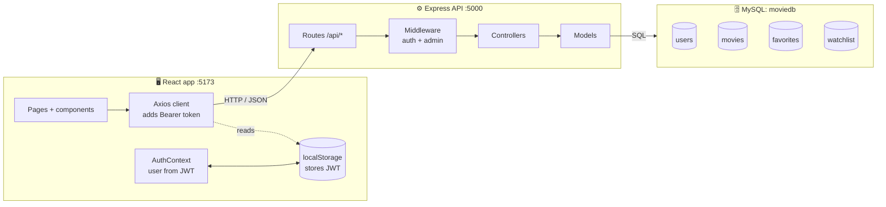
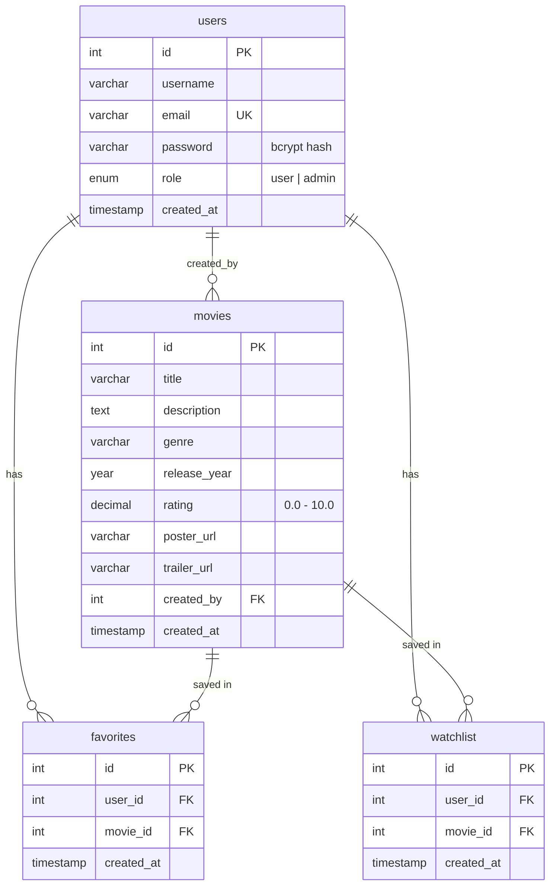
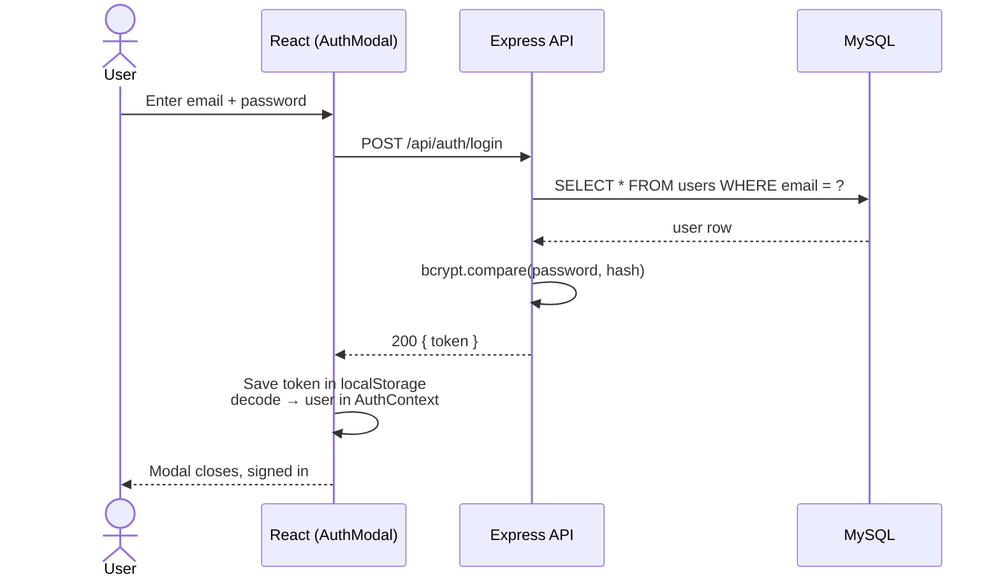
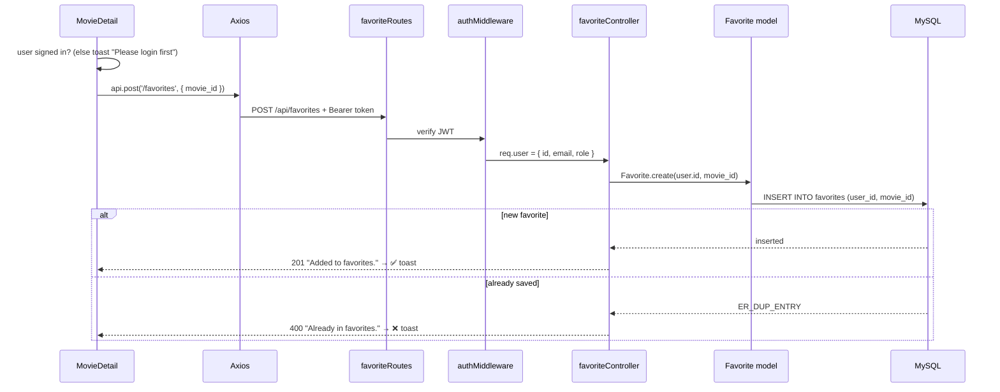

# 🎬 CineVault — System Documentation

> **Last updated:** Oct 28, 2026
> A full-stack movie catalogue: **React** frontend → **Express** REST API → **MySQL** database.

---

## 📑 Table of Contents

1. [Overview](#1-overview)
2. [Quick Start](#2-quick-start)
3. [Backend](#3-backend)
4. [Database Schema](#4-database-schema)
5. [Authentication & Authorization](#5-authentication--authorization)
6. [API Reference](#6-api-reference)
7. [Frontend](#7-frontend)
8. [Request Flows](#8-request-flows)
9. [Known Issues](#9-known-issues)

---

## 1. Overview

CineVault lets users **browse and search movies**, keep a personal **watchlist** and **favorites**, and lets **admins** add, edit and delete movies.

| Layer | Technology | Location | Port |
| --- | --- | --- | --- |
| 🖥️ Frontend | React 19, Vite 8, React Router 7, Axios, react-hot-toast, jwt-decode | `frontend/` | `5173` |
| ⚙️ Backend | Node.js, Express 5, mysql2, bcryptjs, jsonwebtoken, dotenv, cors | `backend/` | `5000` |
| 🗄️ Database | MySQL — database `moviedb`, 4 tables | `backend/database/setup.sql` | `3306` |

### Architecture



**Key ideas**

- 🔐 **Stateless auth** — the API issues a JWT at login; the browser keeps it in `localStorage` and sends it as `Authorization: Bearer <token>`.
- 🚪 The **Axios client** is the frontend's only way to reach the API; **Models** are the only backend code that talks to MySQL.
- 📦 The home page falls back to bundled **mock movies** if the API is offline, so the UI still renders.

---

## 2. Quick Start

**Prerequisites:** Node.js and a running MySQL server.

### Step 1 — Create the database (once)

```bash
mysql -u root -p < backend/database/setup.sql
```

Creates `moviedb`, 4 tables, an admin user, a demo user and 5 sample movies.

### Step 2 — Configure `backend/.env`

```env
PORT=5000
NODE_ENV=development

DB_HOST=localhost
DB_PORT=3306
DB_USER=root
DB_PASSWORD=your_password
DB_NAME=moviedb

JWT_SECRET=a_long_random_string
JWT_EXPIRES_IN=7d
```

| Variable | Purpose |
| --- | --- |
| `PORT` | Port the API listens on |
| `NODE_ENV` | Not read by the code today |
| `DB_HOST` / `DB_PORT` | MySQL connection |
| `DB_USER` / `DB_PASSWORD` | MySQL login |
| `DB_NAME` | Must be `moviedb` (the README's `movie_db` is wrong) |
| `JWT_SECRET` | Signs and verifies tokens |
| `JWT_EXPIRES_IN` | Token lifetime |

### Step 3 — Start the backend (terminal 1)

```bash
cd backend
npm install
npm run dev      # auto-restarts on changes  (or: npm start)
```

> 💡 On Windows you can double-click `start-backend.bat` instead.
> ✅ Health check: open <http://localhost:5000/api/health> → `{"status":"OK"}`

### Step 4 — Start the frontend (terminal 2)

```bash
cd frontend
npm install
npm run dev
```

Open <http://localhost:5173>.

> ℹ️ The frontend reads one optional variable, `VITE_API_URL` (default `http://localhost:5000/api`).
> The API only accepts browser requests from `http://localhost:5173` (CORS in `server.js`).

---

## 3. Backend

The API is layered **routes → middleware → controllers → models**, with one file per resource in each layer.

```
backend/
├── server.js              # App setup, CORS, JSON parsing, mounts routers, error handler
├── config/
│   └── db.js              # mysql2 connection pool (10 connections)
├── routes/                # URL + method → controller (+ middleware)
│   ├── authRoutes.js
│   ├── movieRoutes.js
│   ├── favoriteRoutes.js
│   └── watchlistRoutes.js
├── middleware/
│   ├── authMiddleware.js  # Verifies JWT → req.user
│   └── adminMiddleware.js # Requires role = admin
├── controllers/           # Validate input, call models, build JSON response
├── models/                # User, Movie, Favorite, Watchlist — parameterised SQL
├── database/
│   └── setup.sql          # Schema + seed data
└── uploads/               # Served at /uploads (unused so far)
```

| Piece | What it does |
| --- | --- |
| **`server.js`** | Registers CORS (origin `http://localhost:5173`), `express.json()`, static `/uploads`; mounts the 4 routers under `/api`; adds `/api/health` and a global error handler |
| **`authMiddleware`** | Reads the Bearer token and verifies it with `JWT_SECRET`. ❌ No token → `401` · ❌ Invalid/expired → `403` |
| **`adminMiddleware`** | Runs after auth; `403` unless `req.user.role === 'admin'` |
| **Controllers** | Validate input and map errors (e.g. MySQL `ER_DUP_ENTRY` → `400 "Already in favorites"`) |
| **Models** | Plain objects of async functions running SQL through the pool |

> 🛡️ All SQL uses `?` placeholders, so user input is never concatenated into queries.

---

## 4. Database Schema



**Rules to remember**

- `users.email` is **unique**.
- `favorites` and `watchlist` have a **unique `(user_id, movie_id)`** key, so a movie can be saved only once per user.
- Deleting a user or movie **cascades** to their favorites and watchlist rows.
- Deleting a user sets `movies.created_by` to `NULL`.

**Seed data:** `admin@cinevault.com` (admin), `demo@cinevault.com` (user), and 5 movies (ids 1–5).

---

## 5. Authentication & Authorization

The token payload is `{ id, email, role }`, signed with `JWT_SECRET` and valid for **7 days**. The server keeps no sessions.

### Login flow



> 🔄 On page reload, `AuthContext` re-reads the token from `localStorage`, so the user stays signed in.

### Who protects what

| Layer | Where | Behaviour |
| --- | --- | --- |
| Frontend | **Axios request interceptor** | Adds `Authorization: Bearer <token>` to every request |
| Backend | **`authMiddleware`** | `401` without a token, `403` if invalid or expired |
| Backend | **`adminMiddleware`** | `403` for non-admins on movie create / update / delete |
| Frontend | **`ProtectedRoute`** | `/favorites`, `/watchlist`, `/admin/*` → redirects to `/login` (signed out) or `/` (not admin) |
| Frontend | **Axios response interceptor** | On `401`: deletes the token and redirects to `/login` |

> ⚠️ The frontend checks only control navigation. **The backend middleware is what actually enforces access.**
> Sign-out only deletes the token locally; the token itself stays valid until it expires.

---

## 6. API Reference

**Base URL:** `http://localhost:5000/api`

| Badge | Meaning |
| --- | --- |
| 🌐 Public | No token needed |
| 👤 User | Valid Bearer token required |
| 🛡️ Admin | Token with `role: admin` required |

All errors return `{ "message": "..." }`; `500` errors also include `error`.

### 🔑 Auth

| Method | Endpoint | Access | Body | Response |
| --- | --- | --- | --- | --- |
| `POST` | `/auth/signup` | 🌐 | `{ username, email, password }` | `201 { message, token }` |
| `POST` | `/auth/login` | 🌐 | `{ email, password }` | `200 { message, token, user }` |
| `GET` | `/auth/me` | 👤 | — | `200 { user: { id, username, email, role } }` |

**Errors:** `400` missing fields / email taken · `401` wrong credentials · `404` user not found

### 🎞️ Movies

| Method | Endpoint | Access | Input | Response |
| --- | --- | --- | --- | --- |
| `GET` | `/movies` | 🌐 | `?page=1&limit=20` | `200 { movies, pagination }` (newest first) |
| `GET` | `/movies/search` | 🌐 | `?q=` *(required)* | `200 { movies }` — matches title or genre |
| `GET` | `/movies/:id` | 🌐 | — | `200 { movie }` |
| `POST` | `/movies` | 🛡️ | movie fields | `201 { message, movie }` |
| `PUT` | `/movies/:id` | 🛡️ | movie fields (all overwritten) | `200 { message }` |
| `DELETE` | `/movies/:id` | 🛡️ | — | `200 { message }` |

**Movie fields:** `title, description, genre, release_year, rating, poster_url, trailer_url`
**Errors:** `400` search without `q` · `404` movie not found

### ❤️ Favorites & 📌 Watchlist

Both work the same way and always act on the **signed-in user's own list**.

| Method | Endpoint | Access | Body | Response |
| --- | --- | --- | --- | --- |
| `GET` | `/favorites` | 👤 | — | `200 { favorites: [...] }` |
| `POST` | `/favorites` | 👤 | `{ movie_id }` | `201 { message }` |
| `DELETE` | `/favorites/:movieId` | 👤 | — | `200 { message }` |
| `GET` | `/watchlist` | 👤 | — | `200 { watchlist: [...] }` |
| `POST` | `/watchlist` | 👤 | `{ movie_id }` | `201 { message }` |
| `DELETE` | `/watchlist/:movieId` | 👤 | — | `200 { message }` |

**List item shape:**

```json
{
  "id": 7,
  "movie_id": 2,
  "created_at": "2026-10-28T10:00:00.000Z",
  "title": "Inception",
  "genre": "Sci-Fi",
  "release_year": 2010,
  "rating": "8.8",
  "poster_url": "https://..."
}
```

> ⚠️ `id` is the **favorite/watchlist row id**, not the movie id. Use `movie_id` for the movie.

**Errors:** `400` missing `movie_id` / already in list

### 🩺 Other

| Method | Endpoint | Access | Response |
| --- | --- | --- | --- |
| `GET` | `/health` | 🌐 | `200 { "status": "OK" }` |
| `GET` | `/uploads/<file>` | 🌐 | Static file (outside `/api`) |

### Example request

```bash
curl -X POST http://localhost:5000/api/favorites \
  -H "Authorization: Bearer <token>" \
  -H "Content-Type: application/json" \
  -d '{"movie_id": 2}'

# → 201 {"message":"Added to favorites."}
```

---

## 7. Frontend

A Vite + React single-page app with **one global context** (auth), **one shared Axios client**, and **one page per route**. All styling lives in `src/index.css` using CSS variables.

```
frontend/src/
├── main.jsx               # Mounts <App />
├── App.jsx                # AuthProvider + Router + Navbar/Routes/AuthModal/Footer/Toaster
├── index.css              # All styles (CSS variables: --accent, --bg, ...)
├── api/
│   └── axios.js           # Shared client: base URL, token, 401 handling
├── context/
│   └── AuthContext.jsx    # user, token, isAdmin, login(), logout(), modal state
├── components/            # Navbar, AuthModal, SearchBar, MovieRow, MovieCard,
│                          # ProtectedRoute, Loader, ErrorMessage, Footer
├── pages/                 # Home, MovieDetail, Search, Login, Signup,
│   │                      # Favorites, Watchlist
│   └── admin/             # AdminDashboard, AddMovie, EditMovie
└── data/
    └── mockMovies.js      # Offline sample movies
```

### Routes

| Path | Page | Access | API calls |
| --- | --- | --- | --- |
| `/` | `Home` | 🌐 | `GET /movies?limit=100` (falls back to mock data) |
| `/movie/:id` | `MovieDetail` | 🌐 *(buttons need sign-in)* | `GET /movies/:id`, `POST /favorites`, `POST /watchlist` |
| `/search?q=` | `Search` | 🌐 | `GET /movies/search?q=` |
| `/login` · `/signup` | `Login` · `Signup` | 🌐 | `POST /auth/login` · `POST /auth/signup` |
| `/favorites` | `Favorites` | 👤 | `GET /favorites`, `DELETE /favorites/:movieId` |
| `/watchlist` | `Watchlist` | 👤 | `GET /watchlist`, `DELETE /watchlist/:movieId` |
| `/admin` | `AdminDashboard` | 🛡️ | `GET /movies?limit=100`, `DELETE /movies/:id` |
| `/admin/add` | `AddMovie` | 🛡️ | `POST /movies` |
| `/admin/edit/:id` | `EditMovie` | 🛡️ | `GET /movies/:id`, `PUT /movies/:id` |

### Key components

| Component | Role |
| --- | --- |
| `Navbar` | Logo, nav links (Favorites / Admin shown by role), search, sign-in / sign-out |
| `AuthModal` | Popup login / signup form; closes on Escape or backdrop click |
| `ProtectedRoute` | Guards signed-in and admin-only pages |
| `MovieRow` | Horizontal scrolling row of cards with arrows (Home) |
| `MovieCard` | Poster, rating, title; links to `/movie/:id`; heart toggles favorite |
| `SearchBar` | Navigates to `/search?q=...` on submit |
| `Loader` / `ErrorMessage` | Spinner and error box |

### The pattern every data page follows

```jsx
const [data, setData]       = useState([]);
const [loading, setLoading] = useState(true);
const [error, setError]     = useState(null);

useEffect(() => {
  api.get('/endpoint')
    .then(res => setData(res.data.items))
    .catch(() => setError('Failed to load.'))
    .finally(() => setLoading(false));
}, []);

if (loading) return <Loader />;
if (error)   return <ErrorMessage message={error} />;
// ...render data, show a toast after each user action
```

---

## 8. Request Flows

Every action follows the same path:

```
Component → Axios → Router → Middleware → Controller → Model → MySQL
                                                                 ↓
     Toast + state update ← JSON response ←──────────────────────┘
```

### Traced end to end: clicking ❤️ Favorite on a movie page



### Other actions at a glance

| User action | Frontend | API | Database |
| --- | --- | --- | --- |
| Open home page | `Home` | `GET /movies?limit=100` | `SELECT ... ORDER BY created_at DESC` (grouped by genre in the browser) |
| Search | `SearchBar` → `Search` | `GET /movies/search?q=` | `WHERE title LIKE ? OR genre LIKE ?` |
| Open a movie | `MovieCard` → `MovieDetail` | `GET /movies/:id` | `SELECT ... WHERE id = ?` |
| Sign up | `AuthModal` / `Signup` | `POST /auth/signup` | Check email → bcrypt hash → `INSERT INTO users` |
| View watchlist | `Watchlist` | `GET /watchlist` | `watchlist JOIN movies WHERE user_id = ?` |
| Remove from watchlist | Trash button | `DELETE /watchlist/:movieId` | `DELETE ... WHERE user_id = ? AND movie_id = ?` |
| Admin adds movie | `AddMovie` | `POST /movies` | `INSERT INTO movies` |
| Admin edits movie | `EditMovie` | `GET` → `PUT /movies/:id` | `UPDATE movies ... WHERE id = ?` |
| Admin deletes movie | Dashboard | `DELETE /movies/:id` | `DELETE FROM movies` (cascades to lists) |

---

## 9. Known Issues

### 🐞 Bugs (break visible behaviour)

#### 1. Demo / admin logins don't work
- **Where:** `backend/database/setup.sql`
- **Problem:** Both users share one password hash, and it matches none of `admin123`, `demo123` or `password`.
- **Fix:** Generate real hashes with `bcrypt.hash('admin123', 12)` and `bcrypt.hash('demo123', 12)` and put them in the seed.

#### 2. Expired tokens are never cleared
- **Where:** `authMiddleware` returns `403`; the Axios interceptor only handles `401`.
- **Problem:** After 7 days the user still looks signed in, but every protected call fails.
- **Fix:** Return `401` for invalid or expired tokens, or also handle `403` in the interceptor.

#### 3. Favorites / Watchlist cards open the wrong movie
- **Where:** `Favorites.jsx`, `Watchlist.jsx` → `MovieCard`
- **Problem:** `MovieCard` uses `movie.id`, but list rows' `id` is the row id, not the movie id.
- **Fix:** `<MovieCard movie={{ ...item, id: item.movie_id }} />`

#### 4. Hero "Add to Watchlist" saves nothing
- **Where:** `Home.jsx` → `handleAddToWatchlist`
- **Problem:** Shows a success toast without calling the API; the hero movie is hard-coded.
- **Fix:** Feature a real movie from the API and call `POST /watchlist`.

### 📝 Smaller gaps

- [ ] The heart on `MovieCard` always starts empty; cards don't know which movies are already favorites.
- [ ] No validation on movie create/update: empty `title` is allowed, `rating` isn't limited to 0–10, and `PUT` nulls any fields that aren't sent.
- [ ] Signup tokens have no `username`; the `user` object returned by login is ignored.
- [ ] `GET /movies` defaults to 20 results; the home page asks for 100 and has no pagination.
- [ ] Home rows use fixed genre names, so genres like *Crime* show only in Trending / Top Rated.
- [ ] CORS origin is hard-coded to `http://localhost:5173`; read it from an env variable for deployment.
- [ ] `JWT_SECRET` must be a long random string outside development (the README's `secretkey` is unsafe).
- [ ] `500` responses expose raw error messages, which can leak database details.
- [ ] README says `DB_NAME=movie_db`; the schema uses `moviedb`.
